# info-video

**대본만 쓰면 실사 스톡·AI 내레이션·움직이는 그래프가 들어간 설명 영상을 가로·세로·쇼츠형 3종으로 자동으로 만들어 주는 Claude 스킬**

얼굴 없이 목소리로 이슈나 지식을 설명하는 유튜브·릴스·쇼츠 영상용입니다.
실사 화면은 [픽사베이](https://pixabay.com) 무료 스톡, 목소리는 [일레븐랩스](https://elevenlabs.io), 그래프와 카드는 HTML 애니메이션으로 직접 그립니다. AI로 만든 이미지는 쓰지 않습니다.

## 예시 영상 (소리 있음)

'AI로 인한 대학 시험 부정행위'를 주제로 템플릿 22종을 한 번씩 보여주는 약 2분짜리 영상입니다. 내레이션은 일레븐랩스 클론 목소리입니다.
**이미지를 누르면 소리 있는 영상(mp4)이 열립니다.**

| 가로형 (유튜브) | 세로 쇼츠형 (쇼츠·릴스) |
|---|---|
| <a href="https://github.com/woolfie1101/info-video/releases/download/showcase-1/showcase-wide.mp4"></a> | <a href="https://github.com/woolfie1101/info-video/releases/download/showcase-1/showcase-shorts.mp4"></a> |
| [▶ 가로형 영상 보기](https://github.com/woolfie1101/info-video/releases/download/showcase-1/showcase-wide.mp4) | [▶ 쇼츠형 영상 보기](https://github.com/woolfie1101/info-video/releases/download/showcase-1/showcase-shorts.mp4) |

> 영상 파일은 [릴리스 페이지](https://github.com/woolfie1101/info-video/releases/tag/showcase-1)에도 있습니다.

---

## 무엇을 만들어 주나요

같은 대본 하나로 세 가지 형식이 한 번에 나옵니다. (아래는 같은 장면을 세 형식으로 만든 것)

| ① 가로형 `h` | ② 세로 기본형 `v` | ③ 세로 쇼츠형 `f` |
|:---:|:---:|:---:|
| 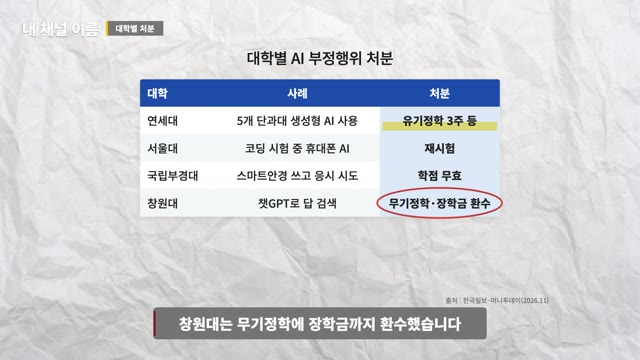 | 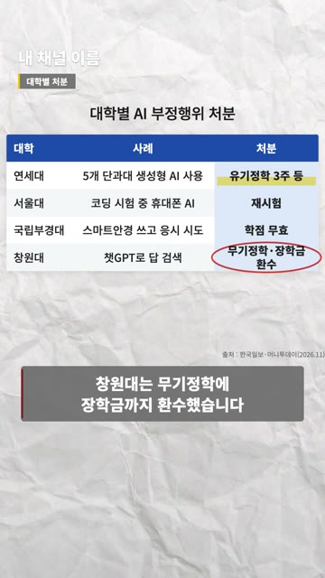 | 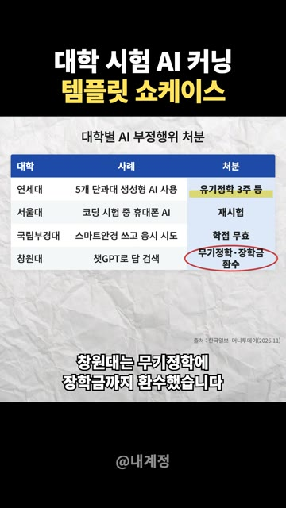 |

| 형식 | 크기 | 쓰는 곳 | 화면 구성 |
|---|---|---|---|
| `h` 가로형 | 1920×1080 | 유튜브 | 왼쪽 위 채널명·소주제, 아래 자막 바 |
| `v` 세로 기본형 | 1080×1920 | 쇼츠·릴스 | 위에 채널명, 자막은 하단 버튼에 안 가리는 높이 |
| `f` 세로 쇼츠형 | 1080×1920 | 쇼츠·릴스 | 검은 바탕, 위에 2줄 제목, 가운데 정사각 영상, 아래 계정명 |

---

## 쓸 수 있는 화면 스타일 (34종)

| 묶음 | 개수 | 템플릿 |
|---|---|---|
| 흰 종이 슬라이드 | 8 | 표 · 가로 막대 · 선 그래프 · 세로 막대 · 수치 카드 · 원형 비교 · 아이콘 흐름도 · 세로 연혁 |
| 실사 위에 얹기 | 12 | 어두운 내레이션 카드 · 황갈색 인용 박스 · 큰 숫자 · 흐린 사진+글 · 말풍선 · 헤드라인 띠 · 라벨 콜아웃 · 위치 핀 · 숫자 대결 · 키네틱 큰 글자 · 강조 도장 · 실사 위 막대 차트 |
| 어두운 단독 화면 | 2 | 인물 인용 · 용어 정의 |
| 일반 스타일 | 12 | 막대그래프 · 아이콘 카드 · 인용 카드 · 숫자 비교 · 도넛 · 가로 타임라인 · 순위 막대 · 큰 숫자 · 기사 제목 카드 · 단계 흐름 · 대결 비교 · 사진 액자 |

아래 모든 템플릿 이미지는 실제로 움직이는 모습(GIF)입니다. 앞의 22종은 한국 지식 설명 유튜브 영상들을 프레임 단위로 분석해, 자주 쓰는 화면 틀을 그대로 움직이는 템플릿으로 만든 것입니다.
모든 템플릿은 내레이션 박자에 맞춰 움직이며 등장하고, 자막·채널명 자리와 겹치지 않는 칸 안에만 그려집니다. 설정 예시는 [references/graphics.md](references/graphics.md)에 있습니다.

### 흰 종이 슬라이드

구겨진 흰 종이 배경. 내용 전체가 블러+페이드로 들어오고(0.35초) 데이터가 0.5~1초 안에 채워집니다(화면 줌은 없음). 이 위에서는 자막 바·소주제 이름표가 자동으로 회색이 됩니다.

| 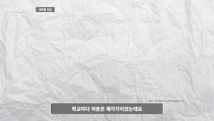 | 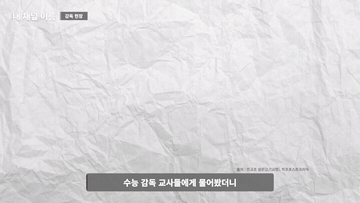 | 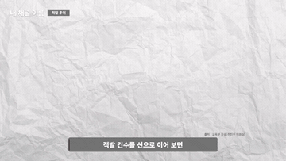 |
|---|---|---|
| **흰 표** `table`<br>남색 머리행, 줄무늬 행, 강조 열은 연파랑 | **가로 막대** `hbar`<br>회색 트랙 위 파란 막대가 왼쪽→오른쪽으로 자람 | **선 그래프** `line`<br>진회색 선이 왼쪽→오른쪽으로 그려지고 회색 그라데이션 면적, 흰 원 데이터점+굵은 숫자 |

| 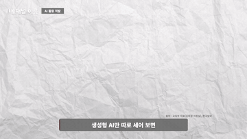 | 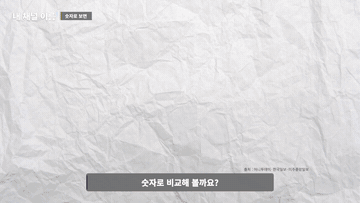 | 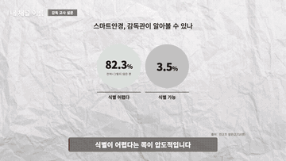 |
|---|---|---|
| **세로 막대** `vbar`<br>회색 막대 + 강조 막대만 진파랑, 위에 숫자 카운트업, 아래 명조체 한 줄 설명(`caption`, **굵게**는 빨강) | **수치 카드** `statcards`<br>2~3칸 카드: 파란 머리 → 이전/이후 숫자 → 연파랑 줄에 '변화' 칩과 증감 | **원형 비교** `circles`<br>큰 원 2~3개가 차례로 튀어나오고 가운데 %가 소수점까지 올라감 |

| 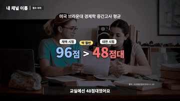 | 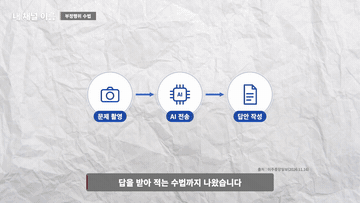 |
|---|---|
| **아이콘 흐름도** `flow`<br>파란 테두리 원 아이콘 + 아래 이름 칩 + 파란 화살표 | **세로 연혁** `history`<br>왼쪽 파란 날짜, 세로선과 점, 오른쪽 회색 줄 위 내용 |

### 실사 위에 얹기

장면에 `pixabay_video`(또는 `pixabay_image`)와 `graphic`을 함께 적으면, 그래픽이 투명 배경으로 만들어져 실사 위에 합성됩니다.

| 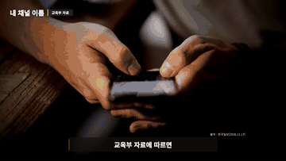 | 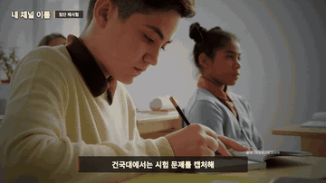 | 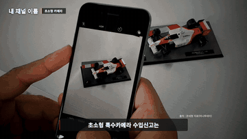 |
|---|---|---|
| **어두운 내레이션 카드** `darkcard`<br>실사를 어둡게 깔고 가운데 명조체 흰 글씨가 한 글자씩 타자로 | **황갈색 인용 박스** `tanbox`<br>실사 위 베이지 박스(갈색 테두리), 명조체 검정 글씨 타자, **굵게**는 진빨강 | **큰 숫자** `number`<br>흰 이름표 + 하늘색 큰 숫자가 0부터 올라감(소수점·쉼표 지원) + 아래 설명 |

| 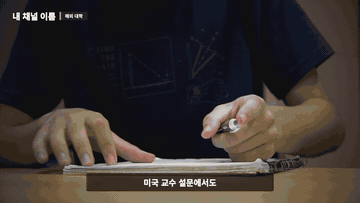 | 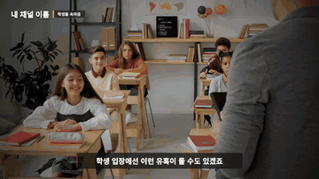 | 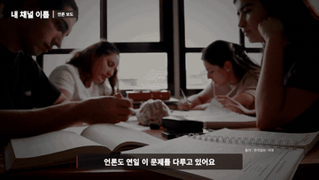 |
|---|---|---|
| **흐린 사진 + 글** `faded`<br>실사를 흰색으로 70% 덮고 명조체 검정 글씨 타자, **굵게**는 빨강 | **말풍선** `bubble`<br>흰 둥근 말풍선(손글씨풍 굵은 글씨)이 꼬리 쪽에서 늘어나며 톡 튀어나옴 | **헤드라인 띠** `headbar`<br>실사 위 흰 가로 띠에 기사 제목, 핵심어만 빨강 |

| 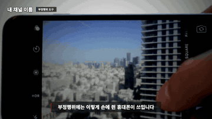 | 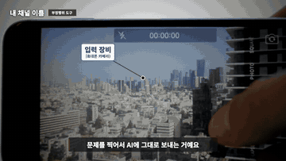 | 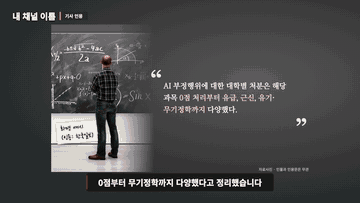 |
|---|---|---|
| **라벨 콜아웃** `callout`<br>검은 점 → 가는 선이 뻗음 → 파란 빛 테두리 라벨(굵은 제목+작은 부제) | **위치 핀** `pin`<br>항공 실사 위 빨간 핀 + 흰 굵은 지명 | **숫자 대결** `vsnum`<br>어둡게 깐 실사 위 큰 숫자 두 개(파랑·빨강), 가운데 '>' + 노란 알약 메모 |

| 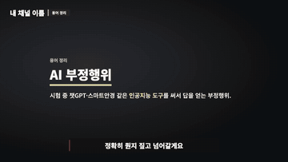 | 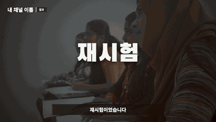 | 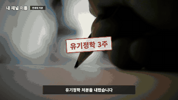 |
|---|---|---|
| **키네틱 큰 글자** `kinetic`<br>화면 가득 크게 튀어나왔다가 줄어들며 자리 잡는 굵은 한 단어 | **강조 도장** `stamp`<br>빨간 테두리 도장이 찍히듯 커졌다 줄어듦 | **실사 위 막대 차트** `vbar`<br>`vbar`에 스톡을 같이 적으면: 어두운 실사 위 파랑·회색 막대 + 흰 숫자 |

### 어두운 단독 화면

실사 없이 자체 배경을 씁니다.

| 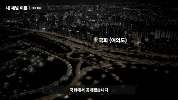 | 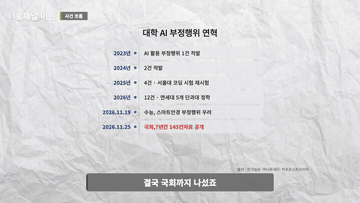 |
|---|---|
| **인물 인용** `portrait`<br>어두운 배경, 왼쪽 인물 사진(`pixabay_image`), 큰 따옴표와 인용문(**굵게**는 노랑), 손글씨 이름표 | **용어 정의** `define`<br>어두운 단색 배경, 큰 용어에 노란 밑줄이 그어지고 설명이 나옴 |

### 일반 스타일

흰 종이 배경에 굵은 검정 테두리·평면 색을 쓰는 스타일입니다. 위 템플릿과 섞어 써도 됩니다.

| 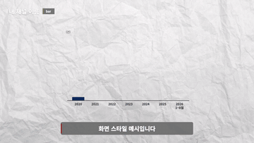 | 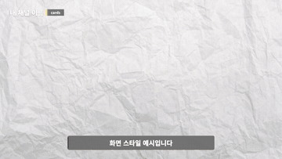 | 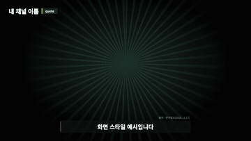 |
|---|---|---|
| **막대그래프** `bar`<br>남색 막대가 아래에서 자라고 말풍선 수치 태그, 강조 막대는 빨강 | **아이콘 카드** `cards`<br>평면 아이콘 카드 2~3장이 하나씩 튀어나옴(아이콘 7종) | **인용 카드** `quote`<br>검정 배경+빛줄기, 명조체 글자가 타자로, 핵심어 노랑 |

| 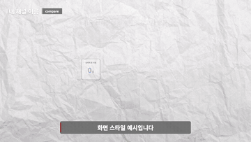 | 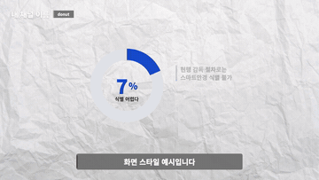 | 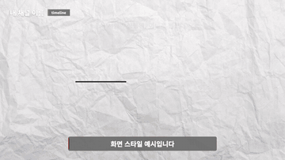 |
|---|---|---|
| **숫자 비교** `compare`<br>이전(파랑)·이후(빨강) 카드 두 장, 숫자가 0부터 올라감 | **도넛** `donut`<br>원이 비율만큼 차오르고 가운데 %가 올라감, 오른쪽 메모 | **가로 타임라인** `timeline`<br>가로선이 그려지고 시점 점과 설명 카드가 차례로 |

| 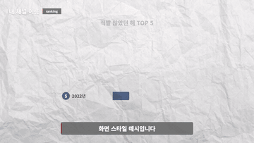 | 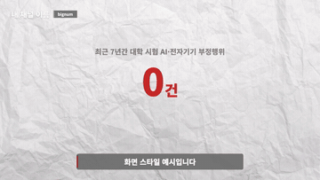 | 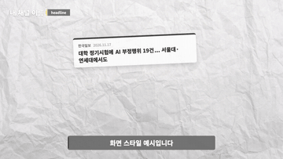 |
|---|---|---|
| **순위 막대** `ranking`<br>1~5위 가로 막대가 아래 순위부터 차례로 자람 | **큰 숫자** `bignum`<br>종이 위 아주 큰 숫자 카운트업 + 밑줄 + 설명 | **기사 제목 카드** `headline`<br>기사 카드가 겹겹이 올라오고 핵심어에 형광펜 |

| 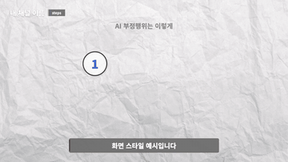 | 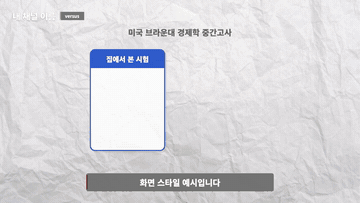 | 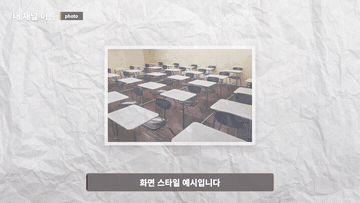 |
|---|---|---|
| **단계 흐름** `steps`<br>1→2→3 번호 원과 화살표가 차례로 | **대결 비교** `versus`<br>두 편 카드를 나란히, 가운데 VS | **사진 액자** `photo`<br>픽사베이 사진을 액자처럼 + 설명, 핵심어에 형광펜 |

### 실사 스톡 장면

- 픽사베이 영상·사진 번호(id)만 적으면 자동으로 받아 옵니다. 약간 어둡게 + 가장자리를 어둡게 처리해 자막이 잘 보이게 합니다
- 만들 영상 방향(가로/세로)에 맞는 걸 먼저 찾고, 없으면 확대하지 않고 필요한 비율만큼 잘라 씁니다
- AI 생성물·애니메이션은 검색 결과에서 자동으로 뺍니다

---

## 화면 틀과 색

- 채널명, 소주제 이름표, 쇼츠형 제목 2줄, 계정명은 설정(`config.json`)에서 정합니다
- 색은 `theme`으로 바꿉니다
```json
"theme": {"accent":"#7a1f2b", "label":"#f5c400", "title_accent":"#ffe45c"}
```
  - `accent`: 자막 바 왼쪽 선(기본 버건디)
  - `label`: 소주제 이름표 선(기본 노랑)
  - `title_accent`: 쇼츠형 제목 2번째 줄(기본 노랑)
- 글꼴: Noto Sans KR(본문), 나눔명조(인용). 구글 폰트라 어느 컴퓨터에서든 같은 모양으로 나옵니다

## 목소리

- 일레븐랩스 `eleven_v4` 모델. 본인 클론 목소리 id를 `voice.voice_id`에 넣으면 그 목소리로 읽습니다
- 대본 전체를 한 번에 읽혀서 문단 사이가 끊기거나 겹치지 않습니다
- 문장 사이 쉼은 0.12초 이하, 전체 1.2배속으로 빠르게 진행합니다(`speed`, `max_gap`으로 조절)
- "7건"은 "칠 건"이 아니라 "일곱 건"으로 읽게 자동으로 바꿉니다
- 일레븐랩스 키가 없으면 맥 기본 음성으로 초안을 만듭니다

---

## 설치 (처음 한 번)
1. ffmpeg: 맥은 `brew install ffmpeg` / 윈도우는 `winget install ffmpeg`
2. uv: `curl -LsSf https://astral.sh/uv/install.sh | sh` (파이썬 패키지는 실행할 때 자동 설치)
3. 크롬이 없으면: `uv run --with playwright playwright install chromium`
4. Claude Code에서 스킬로 쓰려면 이 폴더를 `~/.claude/skills/info-video` 에 두면 됩니다

## 키 넣기 (각자 본인 것)
`~/.config/info-video/.env` (또는 영상 프로젝트 폴더의 `.env`)에 적습니다. 키는 공유하거나 저장소에 올리지 마세요.
```
PIXABAY_API_KEY=여기에_픽사베이_키
ELEVENLABS_API_KEY=여기에_일레븐랩스_키
```
- 픽사베이(필수, 무료): https://pixabay.com/api/docs/ 에 로그인하면 페이지에 내 키가 보입니다
- 일레븐랩스(선택): https://elevenlabs.io → 프로필 → API Keys, 또는 `npx -y @elevenlabs/cli@latest onboard init`

## 만들기
```bash
python3 scripts/init.py ~/videos/내주제     # 예시 설정 복사
# ~/videos/내주제/config.json 을 주제에 맞게 수정
scripts/make.sh ~/videos/내주제             # → out_h.mp4, out_v.mp4, out_f.mp4 (약 6~9분)
```
- 예시 설정 그대로 돌리면 위 샘플 영상이 나옵니다
- 스톡 찾기: `scripts/fetch_stock.py list "exam students" landscape` → `scripts/fetch_stock.py sheet <id,id> 미리보기.jpg` 로 눈으로 보고 고르기
- Claude에게 "OO 주제로 설명 영상 만들어줘"라고 하면 `SKILL.md` 순서대로 조사 → 대본 확인 → 제작까지 진행합니다

## 저작권
- 픽사베이 콘텐츠는 [픽사베이 라이선스](https://pixabay.com/service/license-summary/)를 따릅니다(상업 이용 가능, 원본 그대로 재배포·판매 금지). 이 저장소에는 스톡 원본이 들어 있지 않고 실행할 때 각자 받습니다
- 글꼴: Noto Sans KR, 나눔명조 (SIL OFL)
