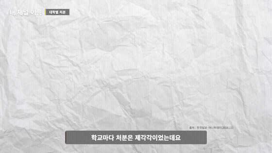
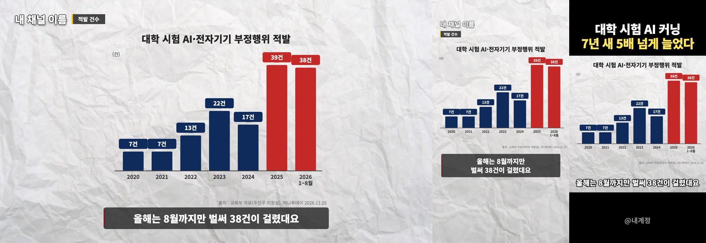
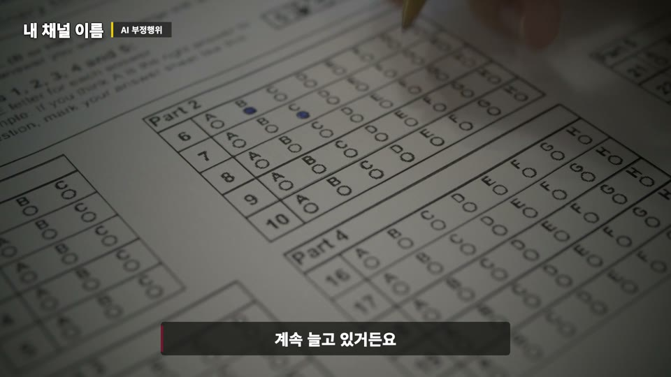
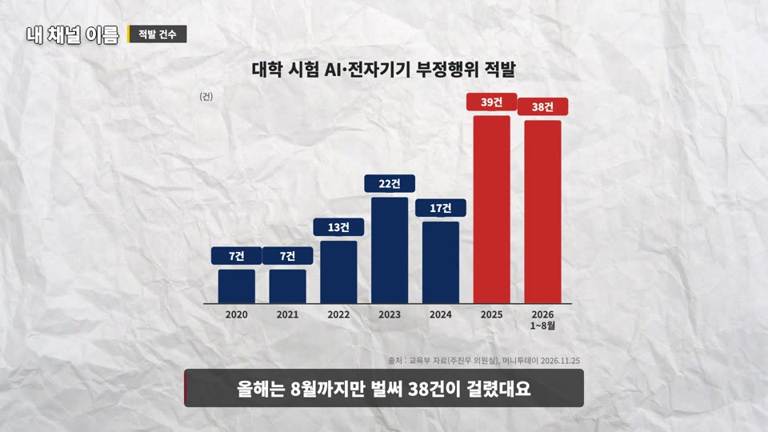
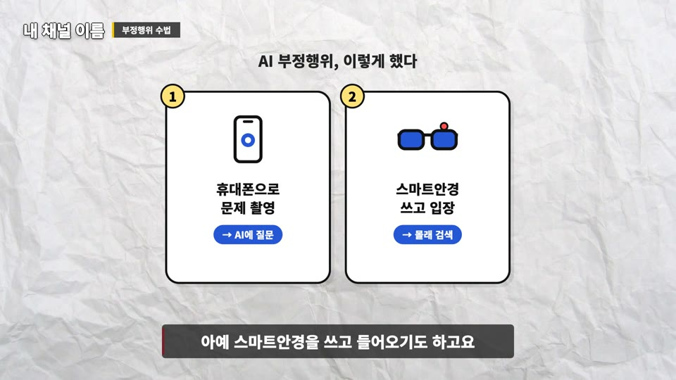
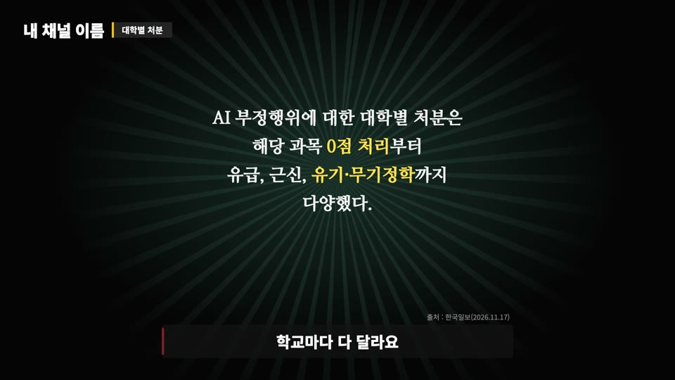
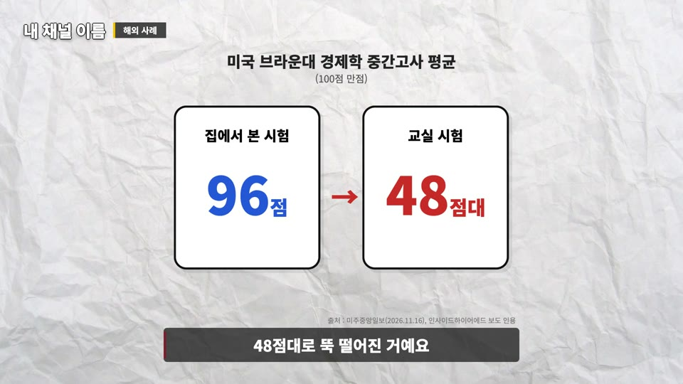

# info-video

**대본만 쓰면 실사 스톡·AI 내레이션·움직이는 그래프가 들어간 설명 영상을 가로·세로·쇼츠형 3종으로 자동으로 만들어 주는 Claude 스킬**

얼굴 없이 목소리로 이슈나 지식을 설명하는 유튜브·릴스·쇼츠 영상용입니다.
실사 화면은 [픽사베이](https://pixabay.com) 무료 스톡, 목소리는 [일레븐랩스](https://elevenlabs.io), 그래프와 카드는 HTML 애니메이션으로 직접 그립니다. AI로 만든 이미지는 쓰지 않습니다.

| 쇼츠형 (세로) | 가로형 |
|---|---|
|  |  |

> 예시: 저장소에 들어 있는 설정 그대로 만든 'AI로 인한 대학 시험 부정행위' 영상 일부 (GIF라 소리는 없음)

---

## 무엇을 만들어 주나요

같은 대본 하나로 세 가지 형식이 한 번에 나옵니다.



| 형식 | 크기 | 쓰는 곳 | 화면 구성 |
|---|---|---|---|
| `h` 가로형 | 1920×1080 | 유튜브 | 왼쪽 위 채널명·소주제, 아래 자막 바 |
| `v` 세로 기본형 | 1080×1920 | 쇼츠·릴스 | 위에 채널명, 자막은 하단 버튼에 안 가리는 높이 |
| `f` 세로 쇼츠형 | 1080×1920 | 쇼츠·릴스 | 검은 바탕, 위에 2줄 제목, 가운데 정사각 영상, 아래 계정명 |

---

## 쓸 수 있는 화면 스타일

장면마다 **실사 스톡** 또는 **그래픽 4종** 중 하나를 고릅니다. 그래픽은 모두 내레이션 박자에 맞춰 움직이며 등장하고, 자막 자리와 겹치지 않는 칸 안에만 그려집니다.

### 1. 실사 스톡 (영상·사진)

- 픽사베이 영상 또는 사진을 번호(id)만 적으면 자동으로 받아 옵니다
- 약간 어둡게 + 가장자리를 어둡게 처리해 자막이 잘 보이게 합니다. 사진은 천천히 확대됩니다
- 만들 영상 방향(가로/세로)에 맞는 걸 먼저 찾고, 없으면 확대하지 않고 필요한 비율만큼 잘라 씁니다
- 실사만 고릅니다: AI 생성물·애니메이션은 검색 결과에서 자동으로 뺍니다

### 2. 막대그래프 `bar`

- 구겨진 종이 배경 위 남색 막대, 말풍선 모양 수치 표시, 강조할 막대는 빨간색
- 움직임: 막대가 아래에서 쑥 자라고, 숫자가 아래에서 위로 드러납니다. 특정 막대만 내레이션의 특정 구절에 맞춰 나오게 할 수 있습니다
```json
{"type":"bar","title":"대학 시험 AI·전자기기 부정행위 적발","unit":"건","suffix":"건",
 "data":[["2020",7],["2021",7],["2025",39],["2026\n1~8월",38]],
 "highlight":[2,3], "at":1, "at_bar":{"2":2,"3":3}, "source":"교육부 자료"}
```

### 3. 아이콘 카드 `cards`

- 굵은 검정 테두리의 평면 아이콘 카드 2~3장, 번호 동그라미
- 움직임: 카드가 하나씩 톡 튀어나옵니다
- 아이콘: 휴대폰, 안경, 문서, 경고, 돈, 시계, 사람
```json
{"type":"cards","title":"AI 부정행위, 이렇게 했다","cards":[
  {"icon":"phone","text":"휴대폰으로<br>문제 촬영","tag":"→ AI에 질문","at":1},
  {"icon":"glasses","text":"스마트안경<br>쓰고 입장","tag":"→ 몰래 검색","at":2}]}
```

### 4. 인용 카드 `quote`

- 검정 배경 + 퍼지는 빛줄기, 명조체 글씨, 핵심 단어만 노란색, 출처 표시
- 움직임: 글자가 한 자씩 타자 치듯 나오고, 빛줄기가 천천히 돕니다
- 기사 문장을 그대로 인용할 때 씁니다
```json
{"type":"quote","lines":["AI 부정행위에 대한 대학별 처분은","해당 과목 0점 처리부터","유급, 근신, 유기·무기정학까지","다양했다."],
 "highlight":["0점 처리","유기·무기정학"],"source":"한국일보(2026.11.17)"}
```

### 5. 숫자 비교 `compare`

- 이전(파랑)과 이후(빨강) 두 카드
- 움직임: 카드가 튀어나오고 숫자가 0부터 올라갑니다
```json
{"type":"compare","title":"미국 브라운대 경제학 중간고사 평균","subtitle":"(100점 만점)",
 "left":{"label":"집에서 본 시험","value":96,"suffix":"점"},
 "right":{"label":"교실 시험","value":48,"suffix":"점대"},"at":[1,2,3]}
```

`at` 값은 "그 장면의 몇 번째 자막이 나올 때 등장할지"(0부터)입니다. 자세한 옵션은 [references/graphics.md](references/graphics.md)에 있습니다.

---

## 화면 틀과 색

- 채널명, 소주제 이름표, 쇼츠형 제목 2줄, 계정명은 설정(`config.json`)에서 정합니다
- 색은 `theme`으로 바꿉니다
```json
"theme": {"accent":"#7a1f2b", "label":"#f5c400", "title_accent":"#ffe45c"}
```
  - `accent`: 자막 바 왼쪽 선(기본 버건디)
  - `label`: 소주제 이름표 선(기본 노랑)
  - `title_accent`: 쇼츠형 제목 2번째 줄(기본 노랑)
- 글꼴: Noto Sans KR(본문), 나눔명조(인용). 구글 폰트라 어느 컴퓨터에서든 같은 모양으로 나옵니다

## 목소리

- 일레븐랩스 `eleven_v4` 모델. 본인 클론 목소리 id를 `voice.voice_id`에 넣으면 그 목소리로 읽습니다
- 대본 전체를 한 번에 읽혀서 문단 사이가 끊기거나 겹치지 않습니다
- 문장 사이 쉼은 0.12초 이하, 전체 1.2배속으로 빠르게 진행합니다(`speed`, `max_gap`으로 조절)
- "7건"은 "칠 건"이 아니라 "일곱 건"으로 읽게 자동으로 바꿉니다
- 일레븐랩스 키가 없으면 맥 기본 음성으로 초안을 만듭니다

---

## 설치 (처음 한 번)
1. ffmpeg: 맥은 `brew install ffmpeg` / 윈도우는 `winget install ffmpeg`
2. uv: `curl -LsSf https://astral.sh/uv/install.sh | sh` (파이썬 패키지는 실행할 때 자동 설치)
3. 크롬이 없으면: `uv run --with playwright playwright install chromium`
4. Claude Code에서 스킬로 쓰려면 이 폴더를 `~/.claude/skills/info-video` 에 두면 됩니다

## 키 넣기 (각자 본인 것)
`~/.config/info-video/.env` (또는 영상 프로젝트 폴더의 `.env`)에 적습니다. 키는 공유하거나 저장소에 올리지 마세요.
```
PIXABAY_API_KEY=여기에_픽사베이_키
ELEVENLABS_API_KEY=여기에_일레븐랩스_키
```
- 픽사베이(필수, 무료): https://pixabay.com/api/docs/ 에 로그인하면 페이지에 내 키가 보입니다
- 일레븐랩스(선택): https://elevenlabs.io → 프로필 → API Keys, 또는 `npx -y @elevenlabs/cli@latest onboard init`

## 만들기
```bash
python3 scripts/init.py ~/videos/내주제     # 예시 설정 복사
# ~/videos/내주제/config.json 을 주제에 맞게 수정
scripts/make.sh ~/videos/내주제             # → out_h.mp4, out_v.mp4, out_f.mp4 (약 6~9분)
```
- 예시 설정 그대로 돌리면 위 샘플 영상이 나옵니다
- 스톡 찾기: `scripts/fetch_stock.py list "exam students" landscape` → `scripts/fetch_stock.py sheet <id,id> 미리보기.jpg` 로 눈으로 보고 고르기
- Claude에게 "OO 주제로 설명 영상 만들어줘"라고 하면 `SKILL.md` 순서대로 조사 → 대본 확인 → 제작까지 진행합니다

## 저작권
- 픽사베이 콘텐츠는 [픽사베이 라이선스](https://pixabay.com/service/license-summary/)를 따릅니다(상업 이용 가능, 원본 그대로 재배포·판매 금지). 이 저장소에는 스톡 원본이 들어 있지 않고 실행할 때 각자 받습니다
- 글꼴: Noto Sans KR, 나눔명조 (SIL OFL)
