# 그래픽 템플릿 (config 장면의 "graphic")

한국 지식 설명 유튜브 영상들을 프레임 단위로 분석해 만든 템플릿입니다. 채널 로고·AI 그림은 쓰지 않습니다.

공통
1. `at`: 그 장면의 몇 번째 자막(0부터)이 나올 때 등장할지 — 내레이션 박자 맞추기
2. `title`(위 제목), `subtitle`, `source`(오른쪽 아래 출처)
3. 글 안의 `**굵게**`는 강조색(밝은 배경은 빨강, 어두운 배경은 노랑)
4. 그래픽은 자막·채널명 자리를 피한 안전 영역 안에만 그려짐(가로·세로·쇼츠형 모두)

## 흰 종이 슬라이드

구겨진 흰 종이 배경. 내용 전체가 블러+페이드로 들어오고(0.35초) 데이터가 0.5~1초 안에 채워집니다(화면 줌은 없음). 이 위에서는 자막 바·소주제 이름표가 자동으로 회색이 됩니다.

### `table` — 흰 표

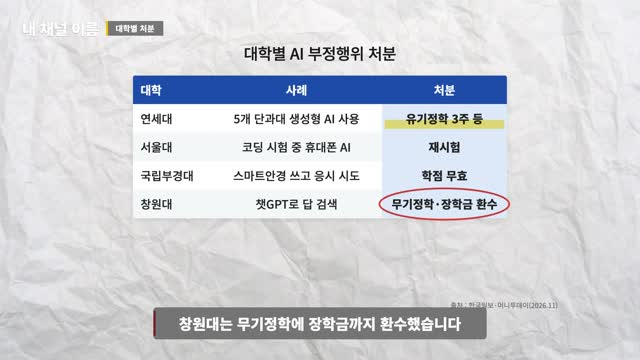

남색 머리행, 줄무늬 행, 강조 열은 연파랑. 표가 살짝 기울어진 채 흐릿하게 들어와 정면으로 펴짐. `marks`로 칸에 노란 형광펜(`marker`)이나 빨간 손그림 동그라미(`circle`)를 내레이션 박자에 맞춰 추가

```json
{
 "graphic": {
  "type": "table",
  "title": "대학별 AI 부정행위 처분",
  "columns": [
   "대학",
   "사례",
   "처분"
  ],
  "widths": [
   1,
   2.2,
   1.6
  ],
  "highlight_col": 2,
  "rows": [
   [
    "연세대",
    "5개 단과대 생성형 AI 사용",
    "유기정학 3주 등"
   ],
   [
    "서울대",
    "코딩 시험 중 휴대폰 AI",
    "재시험"
   ],
   [
    "국립부경대",
    "스마트안경 쓰고 응시 시도",
    "학점 무효"
   ],
   [
    "창원대",
    "챗GPT로 답 검색",
    "무기정학·장학금 환수"
   ]
  ],
  "marks": [
   {
    "row": 0,
    "col": 2,
    "at": 1
   },
   {
    "row": 3,
    "col": 2,
    "at": 2,
    "kind": "circle"
   }
  ],
  "source": "한국일보·머니투데이(2026.11)"
 }
}
```

### `hbar` — 가로 막대

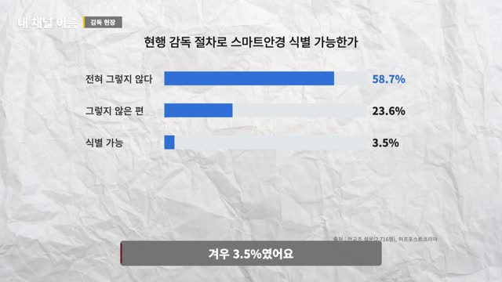

회색 트랙 위 파란 막대가 왼쪽→오른쪽으로 자람. 1위 수치만 파란 글씨(`highlight`로 변경)

```json
{
 "graphic": {
  "type": "hbar",
  "title": "현행 감독 절차로 스마트안경 식별 가능한가",
  "items": [
   [
    "전혀 그렇지 않다",
    58.7
   ],
   [
    "그렇지 않은 편",
    23.6
   ],
   [
    "식별 가능",
    3.5
   ]
  ],
  "suffix": "%",
  "max": 70,
  "at": 1,
  "source": "전교조 설문(2,716명), 허프포스트코리아"
 }
}
```

### `line` — 선 그래프

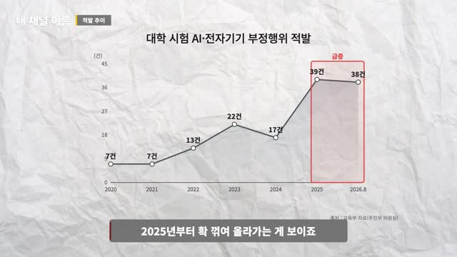

진회색 선이 왼쪽→오른쪽으로 그려지고 회색 그라데이션 면적, 흰 원 데이터점+굵은 숫자. `forecast_from`부터 점선(예측 구간), `boxes`로 빨강/파랑 강조 박스

```json
{
 "graphic": {
  "type": "line",
  "title": "대학 시험 AI·전자기기 부정행위 적발",
  "unit": "건",
  "suffix": "건",
  "data": [
   [
    "2020",
    7
   ],
   [
    "2021",
    7
   ],
   [
    "2022",
    13
   ],
   [
    "2023",
    22
   ],
   [
    "2024",
    17
   ],
   [
    "2025",
    39
   ],
   [
    "2026.8",
    38
   ]
  ],
  "labels": [
   0,
   1,
   2,
   3,
   4,
   5,
   6
  ],
  "boxes": [
   {
    "from": 5,
    "to": 6,
    "label": "급증",
    "at": 1
   }
  ],
  "max": 45,
  "source": "교육부 자료(주진우 의원실)"
 }
}
```

### `vbar` — 세로 막대

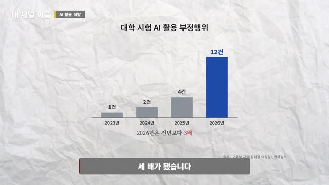

회색 막대 + 강조 막대만 진파랑, 위에 숫자 카운트업, 아래 명조체 한 줄 설명(`caption`, **굵게**는 빨강). 장면에 스톡을 같이 적으면 실사 위 어두운 차트로 바뀜(아래 `overchart`)

```json
{
 "graphic": {
  "type": "vbar",
  "title": "대학 시험 AI 활용 부정행위",
  "data": [
   [
    "2023년",
    1
   ],
   [
    "2024년",
    2
   ],
   [
    "2025년",
    4
   ],
   [
    "2026년",
    12
   ]
  ],
  "suffix": "건",
  "caption": "2026년은 전년보다 **3배**",
  "caption_at": 2,
  "source": "교육부 자료(김희정 의원실), 한국일보"
 }
}
```

### `statcards` — 수치 카드

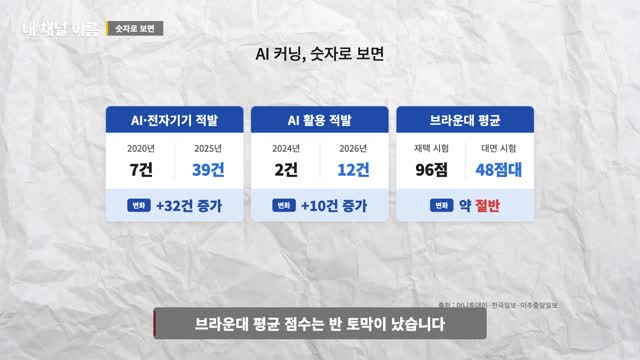

2~3칸 카드: 파란 머리 → 이전/이후 숫자 → 연파랑 줄에 '변화' 칩과 증감. 아래에서 위로 블러 슬라이드

```json
{
 "graphic": {
  "type": "statcards",
  "title": "AI 커닝, 숫자로 보면",
  "cards": [
   {
    "title": "AI·전자기기 적발",
    "before": [
     "2020년",
     "7건"
    ],
    "after": [
     "2025년",
     "39건"
    ],
    "change": "+32건 증가"
   },
   {
    "title": "AI 활용 적발",
    "before": [
     "2024년",
     "2건"
    ],
    "after": [
     "2026년",
     "12건"
    ],
    "change": "+10건 증가"
   },
   {
    "title": "브라운대 평균",
    "before": [
     "재택 시험",
     "96점"
    ],
    "after": [
     "대면 시험",
     "48점대"
    ],
    "change": "약 **절반**"
   }
  ],
  "at": 1,
  "source": "머니투데이·한국일보·미주중앙일보"
 }
}
```

### `circles` — 원형 비교

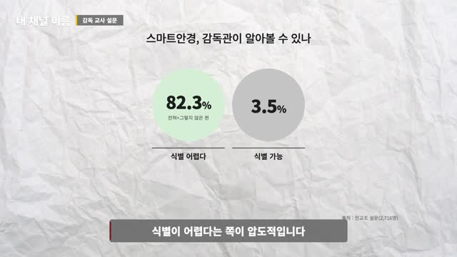

큰 원 2~3개가 차례로 튀어나오고 가운데 %가 소수점까지 올라감. `style: ring`이면 파란 테두리 원. `stamp`로 위에 빨간 도장 추가 가능

```json
{
 "graphic": {
  "type": "circles",
  "title": "스마트안경, 감독관이 알아볼 수 있나",
  "items": [
   {
    "label": "식별 어렵다",
    "value": 82.3,
    "sub": "전혀+그렇지 않은 편"
   },
   {
    "label": "식별 가능",
    "value": 3.5,
    "color": "#c4c4c4"
   }
  ],
  "source": "전교조 설문(2,716명)"
 }
}
```

### `flow` — 아이콘 흐름도

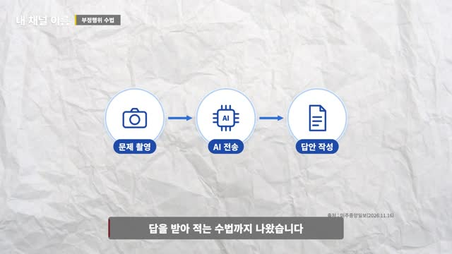

파란 테두리 원 아이콘 + 아래 이름 칩 + 파란 화살표. 아이콘 팝업 → 화살표 → 다음 아이콘 순서로 내레이션에 맞춰 등장. 아이콘: bank, building, school, phone, camera, glasses, ai, document, money, person, people, check, warning, chart, globe, lock, search, clock

```json
{
 "graphic": {
  "type": "flow",
  "steps": [
   {
    "icon": "camera",
    "text": "문제 촬영",
    "at": 0
   },
   {
    "icon": "ai",
    "text": "AI 전송",
    "at": 1
   },
   {
    "icon": "document",
    "text": "답안 작성",
    "at": 2
   }
  ],
  "source": "미주중앙일보(2026.11.16)"
 }
}
```

### `history` — 세로 연혁

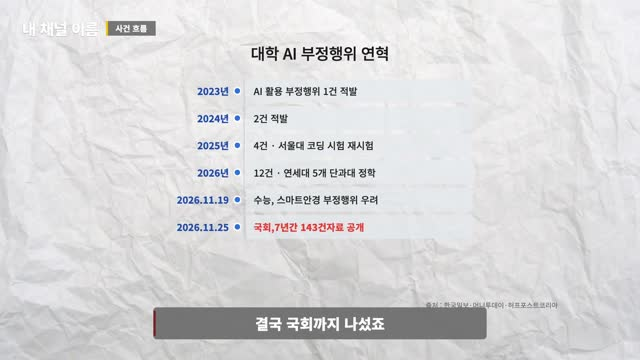

왼쪽 파란 날짜, 세로선과 점, 오른쪽 회색 줄 위 내용. 위에서부터 한 줄씩

```json
{
 "graphic": {
  "type": "history",
  "title": "대학 AI 부정행위 연혁",
  "events": [
   {
    "date": "2023년",
    "text": "AI 활용 부정행위 1건 적발"
   },
   {
    "date": "2024년",
    "text": "2건 적발"
   },
   {
    "date": "2025년",
    "text": "4건 · 서울대 코딩 시험 재시험"
   },
   {
    "date": "2026년",
    "text": "12건 · 연세대 5개 단과대 정학"
   },
   {
    "date": "2026.11.19",
    "text": "수능, 스마트안경 부정행위 우려"
   },
   {
    "date": "2026.11.25",
    "text": "국회, **7년간 143건** 자료 공개"
   }
  ],
  "highlight": [
   5
  ],
  "source": "한국일보·머니투데이·허프포스트코리아"
 }
}
```

## 실사 위에 얹기

장면에 `pixabay_video`(또는 `pixabay_image`)와 `graphic`을 함께 적으면, 그래픽이 투명 배경으로 만들어져 실사 위에 합성됩니다.

### `darkcard` — 어두운 내레이션 카드

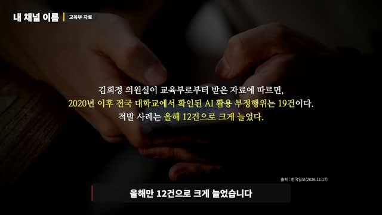

실사를 어둡게 깔고 가운데 명조체 흰 글씨가 한 글자씩 타자로. **굵게**는 노랑

```json
{
 "graphic": {
  "type": "darkcard",
  "lines": [
   "김희정 의원실이 교육부로부터 받은 자료에 따르면,",
   "**2020년 이후 전국 대학교에서 확인된 AI 활용 부정행위는 19건**이다.",
   "적발 사례는 **올해 12건으로 크게 늘었다.**"
  ],
  "type_seconds": 3.2,
  "source": "한국일보(2026.11.17)"
 },
 "pixabay_video": 202987
}
```

### `tanbox` — 황갈색 인용 박스

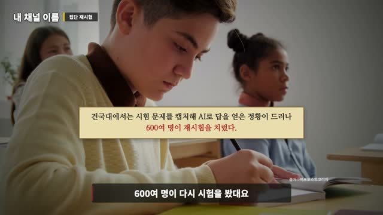

실사 위 베이지 박스(갈색 테두리), 명조체 검정 글씨 타자, **굵게**는 진빨강

```json
{
 "graphic": {
  "type": "tanbox",
  "lines": [
   "건국대에서는 시험 문제를 캡처해 AI로 답을 얻은 정황이 드러나",
   "**600여 명이 재시험을 치렀다.**"
  ],
  "source": "허프포스트코리아"
 },
 "pixabay_video": 215471
}
```

### `number` — 큰 숫자

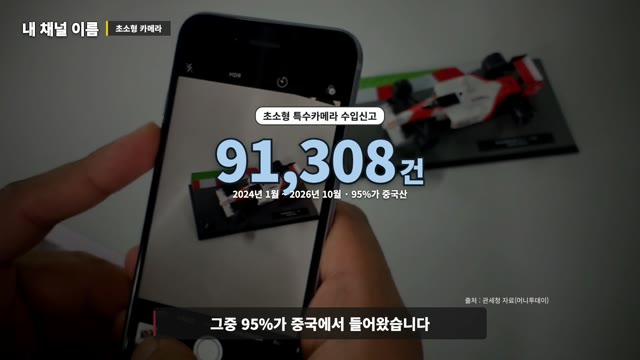

흰 이름표 + 하늘색 입체 큰 숫자가 0부터 올라감(소수점·쉼표 지원) + 아래 설명

```json
{
 "graphic": {
  "type": "number",
  "label": "초소형 특수카메라 수입신고",
  "value": 91308,
  "suffix": "건",
  "sub": "2024년 1월 ~ 2026년 10월 · 95%가 중국산",
  "at": 1,
  "source": "관세청 자료(머니투데이)"
 },
 "pixabay_video": 158618
}
```

### `faded` — 흐린 사진 + 글

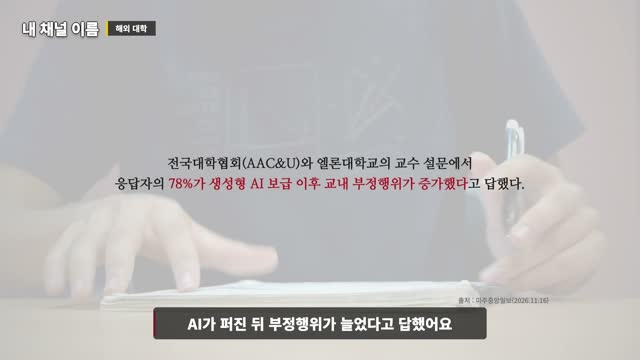

실사를 흰색으로 70% 덮고 명조체 검정 글씨 타자, **굵게**는 빨강

```json
{
 "graphic": {
  "type": "faded",
  "lines": [
   "전국대학협회(AAC&U)와 엘론대학교의 교수 설문에서",
   "응답자의 **78%가 생성형 AI 보급 이후 교내 부정행위가 증가했다**고 답했다."
  ],
  "source": "미주중앙일보(2026.11.16)"
 },
 "pixabay_video": 131990
}
```

### `bubble` — 말풍선

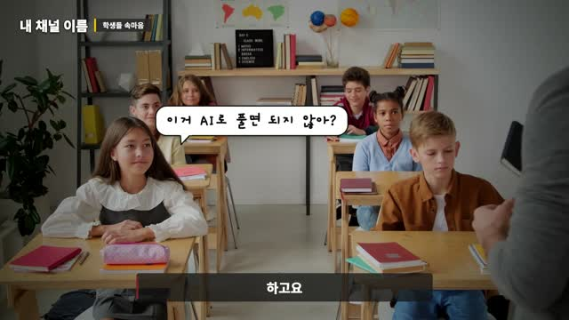

흰 둥근 말풍선(손글씨풍 굵은 글씨)이 꼬리 쪽에서 늘어나며 톡 튀어나옴. 위치 `x`,`y`(0~1), 꼬리 `tail`: left/right/down

```json
{
 "graphic": {
  "type": "bubble",
  "bubbles": [
   {
    "text": "이거 AI로 풀면 되지 않아?",
    "x": 0.42,
    "y": 0.42,
    "tail": "left",
    "at": 1
   }
  ]
 },
 "pixabay_video": 215475
}
```

### `headbar` — 헤드라인 띠

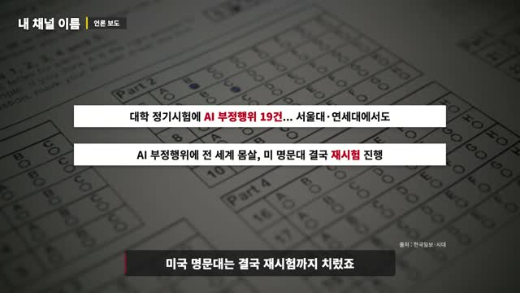

실사 위 흰 가로 띠에 기사 제목, 핵심어만 빨강. 여러 줄 가능

```json
{
 "graphic": {
  "type": "headbar",
  "items": [
   {
    "text": "대학 정기시험에 **AI 부정행위 19건**... 서울대·연세대에서도",
    "at": 0,
    "y": 0.38
   },
   {
    "text": "AI 부정행위에 전 세계 몸살, 미 명문대 결국 **재시험** 진행",
    "at": 1,
    "y": 0.56
   }
  ],
  "source": "한국일보·시대"
 },
 "pixabay_video": 158618
}
```

### `callout` — 라벨 콜아웃

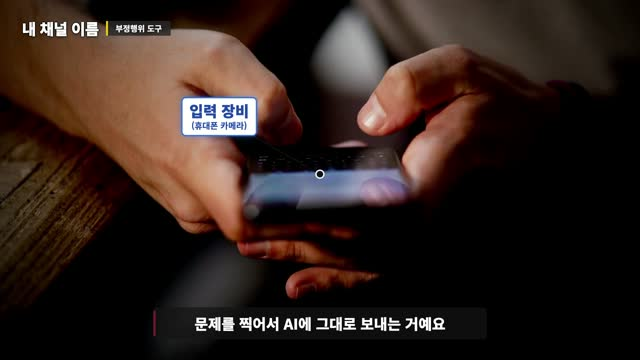

검은 점 → 가는 선이 뻗음 → 파란 빛 테두리 라벨(굵은 제목+작은 부제)

```json
{
 "graphic": {
  "type": "callout",
  "items": [
   {
    "label": "입력 장비",
    "sub": "(휴대폰 카메라)",
    "x": 0.5,
    "y": 0.5,
    "lx": 0.28,
    "ly": 0.28,
    "at": 0
   }
  ]
 },
 "pixabay_video": 202987
}
```

### `pin` — 위치 핀

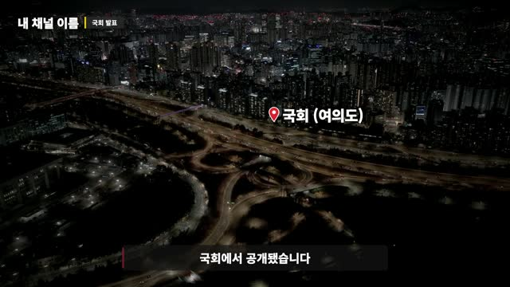

항공 실사 위 빨간 핀 + 흰 굵은 지명

```json
{
 "graphic": {
  "type": "pin",
  "items": [
   {
    "text": "국회 (여의도)",
    "x": 0.55,
    "y": 0.42,
    "at": 1
   }
  ]
 },
 "pixabay_video": 336755
}
```

### `vsnum` — 숫자 대결

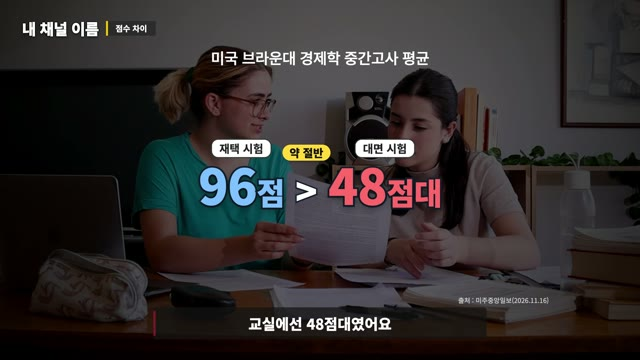

어둡게 깐 실사 위 큰 숫자 두 개(파랑·빨강, 글자 뒤 진한 테두리), 가운데 '>' + 노란 알약 메모. 왼쪽 숫자 → '>' → 오른쪽 숫자 순서

```json
{
 "graphic": {
  "type": "vsnum",
  "title": "미국 브라운대 경제학 중간고사 평균",
  "left": {
   "label": "재택 시험",
   "value": 96,
   "suffix": "점"
  },
  "right": {
   "label": "대면 시험",
   "value": 48,
   "suffix": "점대"
  },
  "memo": "약 절반",
  "at": [
   1,
   1,
   2
  ],
  "source": "미주중앙일보(2026.11.16)"
 },
 "pixabay_video": 215471
}
```

### `kinetic` — 키네틱 큰 글자

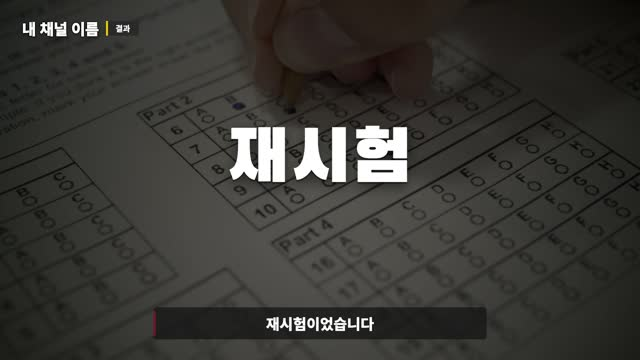

화면 가득 크게 튀어나왔다가 줄어들며 자리 잡는 굵은 한 단어

```json
{
 "graphic": {
  "type": "kinetic",
  "text": "재시험",
  "at": 1
 },
 "pixabay_video": 158618
}
```

### `stamp` — 강조 도장

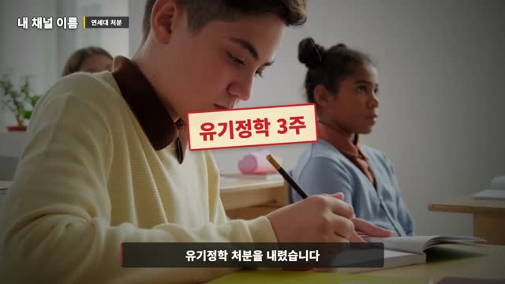

빨간 테두리 도장이 찍히듯 커졌다 줄어듦

```json
{
 "graphic": {
  "type": "stamp",
  "text": "유기정학 3주",
  "at": 1,
  "x": 0.5,
  "y": 0.45
 },
 "pixabay_video": 215471
}
```

### `vbar` — 실사 위 막대 차트 (스톡과 함께)

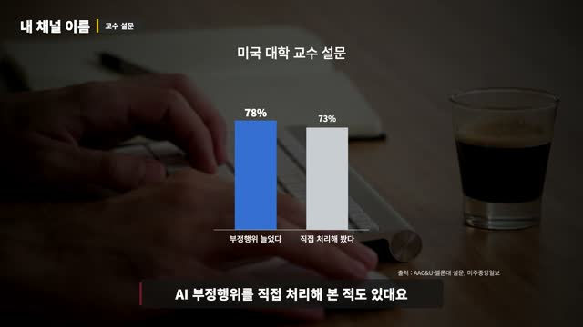

`vbar`에 스톡을 같이 적으면: 어두운 실사 위 파랑·회색 막대 + 흰 숫자

```json
{
 "graphic": {
  "type": "vbar",
  "title": "미국 대학 교수 설문",
  "data": [
   [
    "부정행위 늘었다",
    78
   ],
   [
    "직접 처리해 봤다",
    73
   ]
  ],
  "suffix": "%",
  "max": 100,
  "highlight": [
   0
  ],
  "at": 0,
  "source": "AAC&U·엘론대 설문, 미주중앙일보"
 },
 "pixabay_video": 1046
}
```

## 어두운 단독 화면

실사 없이 자체 배경을 씁니다.

### `portrait` — 인물 인용

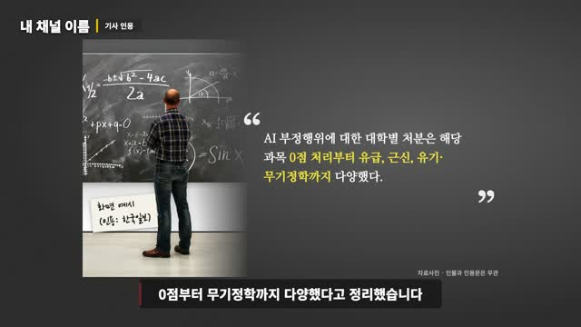

어두운 배경, 왼쪽 인물 사진(`pixabay_image`), 큰 따옴표와 인용문(**굵게**는 노랑), 손글씨 이름표. 실존 인물 사진·발언은 확인된 것만, 아니면 '화면 예시'로 표기

```json
{
 "graphic": {
  "type": "portrait",
  "pixabay_image": 4444443,
  "quote": "AI 부정행위에 대한 대학별 처분은 해당 과목 **0점 처리부터 유급, 근신, 유기·무기정학까지** 다양했다.",
  "name": "화면 예시\n(인용: 한국일보)",
  "credit": "자료사진 · 인물과 인용문은 무관"
 }
}
```

### `define` — 용어 정의 (예전 이름 glitch도 됨)

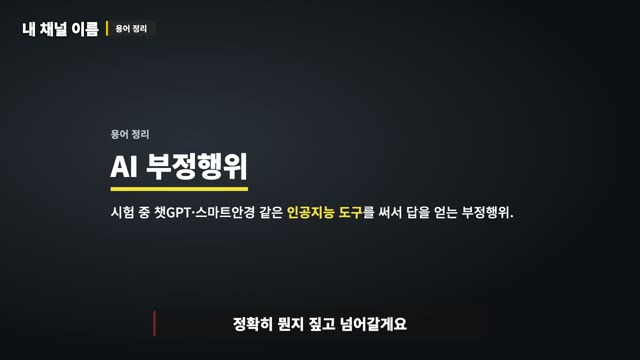

어두운 단색 배경, 큰 용어에 노란 밑줄이 그어지고 아래에 설명이 나옴. `label`(작은 머리글, 기본 "용어 정리")

```json
{
 "graphic": {
  "type": "define",
  "term": "AI 부정행위",
  "definition": "시험 중 챗GPT·스마트안경 같은 **인공지능 도구**를 써서 답을 얻는 부정행위."
 }
}
```

## 그 밖의 기본형

`bar`(종이 위 남색 막대+말풍선 수치), `cards`(아이콘 카드 2~3장), `quote`(검정 배경+빛줄기 인용), `compare`(숫자 비교 카드 2장),
`donut`, `ranking`, `bignum`, `timeline`(가로), `headline`(기사 카드), `steps`, `versus`, `photo`(사진 액자)도 쓸 수 있습니다. 설정은 `scripts/graphics.py`, `scripts/graphics_more.py` 참고.

## 새 템플릿 추가
`scripts/templates_jh.py`에 `fn(si, g, at, ctx) -> (css, body, mode)`를 만들고 `JH`에 등록. mode는 `paper`/`overlay`/`dark`.
SVG 속성은 반드시 따옴표로 감쌀 것(따옴표 없이 `stroke-width=3/>`라고 쓰면 요소가 안 닫혀 뒤 요소가 사라짐).
